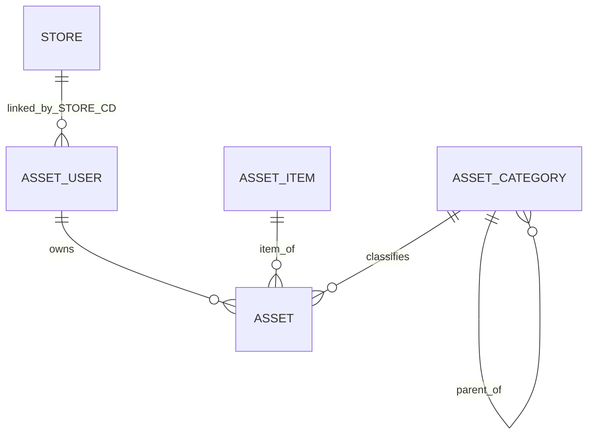

# ABCASSET ERD — 실제 DDL 기준

데이터베이스: `ABCASSET` / 스키마: `dbo`. 이 문서는 현재 SQL 파일에 존재하는 컬럼만 기술한다.

## 테이블 및 컬럼

### dbo.STORE

| 컬럼 | SQL 타입 | NULL | 키/참조 |
|---|---|---|---|
| `STORE_CD` | `[varchar](4)` | 불가 | PK |
| `STORE_NM_KOR` | `[varchar](30)` | 불가 |  |
| `OPEN_STORE_DT` | `[date]` | 허용 |  |
| `RENEWAL_STORE_DT` | `[date]` | 허용 |  |
| `CLOSE_STORE_DT` | `[date]` | 허용 |  |
| `STORE_ST` | `[varchar](50)` | 허용 |  |
| `DIR_JOIN_FLAG` | `[varchar](50)` | 허용 |  |
| `DIRECT_TYPE` | `[varchar](50)` | 허용 |  |
| `STORE_CHANNEL` | `[varchar](50)` | 허용 |  |
| `SENDR_ADDR` | `[varchar](200)` | 허용 |  |
| `SENDR_DETAIL_ADDR` | `[varchar](200)` | 허용 |  |
| `SENDR_ZIP_NO` | `[varchar](10)` | 허용 |  |
| `X_POINT` | `[numeric](10, 5)` | 허용 |  |
| `Y_POINT` | `[numeric](10, 5)` | 허용 |  |

### dbo.ASSET_CATEGORY

| 컬럼 | SQL 타입 | NULL | 키/참조 |
|---|---|---|---|
| `ASSET_CATEGORY_CD` | `[int]` | 불가 | PK |
| `ASSET_CATEGORY_NM` | `[varchar](100)` | 불가 |  |
| `ASSET_CATEGORY_PARENT_CD` | `[int]` | 허용 | FK → `ASSET_CATEGORY.ASSET_CATEGORY_CD` |
| `ASSET_CATEGORY_LEVEL` | `[int]` | 불가 |  |

### dbo.ASSET_ITEM

| 컬럼 | SQL 타입 | NULL | 키/참조 |
|---|---|---|---|
| `ASSET_ITEM_CD` | `[int]` | 불가 | PK |
| `ASSET_ITEM_NM` | `[varchar](250)` | 불가 |  |

### dbo.ASSET_USER

| 컬럼 | SQL 타입 | NULL | 키/참조 |
|---|---|---|---|
| `USER_ID` | `[varchar](30)` | 불가 | PK |
| `USER_NM` | `[varchar](50)` | 불가 |  |
| `USER_TITLE` | `[varchar](50)` | 허용 |  |
| `STORE_CD` | `[varchar](04)` | 허용 | FK → `STORE.STORE_CD` |
| `USE_YN` | `[char](1)` | 허용 |  |

### dbo.ASSET

| 컬럼 | SQL 타입 | NULL | 키/참조 |
|---|---|---|---|
| `ASSET_CODE` | `[varchar](50)` | 불가 | PK |
| `ASSET_ITEM_CD` | `[int]` | 불가 | FK → `ASSET_ITEM.ASSET_ITEM_CD` |
| `ASSET_CATEGORY_CD` | `[int]` | 허용 | FK → `ASSET_CATEGORY.ASSET_CATEGORY_CD` |
| `ASSET_STATUS_CD` | `[char](2)` | 불가 |  |
| `ASSET_STATUS_NM` | `[varchar](4)` | 불가 |  |
| `ASSET_USER` | `[varchar](30)` | 허용 | FK → `ASSET_USER.USER_ID` |
| `NOTE` | `[varchar](500)` | 허용 |  |
| `NOTE2` | `[varchar](500)` | 허용 |  |
| `NOTE3` | `[varchar](500)` | 허용 |  |
| `REG_DATE` | `DATE` | 허용 |  |
| `REG_NM` | `[varchar](50)` | 불가 |  |
| `UPT_DATE` | `DATE` | 허용 |  |
| `UPT_NM` | `[varchar](50)` | 허용 |  |

## 관계 및 제약
- `ASSET_CATEGORY.ASSET_CATEGORY_PARENT_CD`는 같은 테이블 PK를 참조한다. 직접 자기참조 금지 CHECK 존재.
- `ASSET_USER.STORE_CD` → `STORE.STORE_CD`.
- `ASSET.ASSET_USER` → `ASSET_USER.USER_ID`.
- `ASSET.ASSET_CATEGORY_CD` → `ASSET_CATEGORY.ASSET_CATEGORY_CD`.
- `ASSET.ASSET_ITEM_CD` → `ASSET_ITEM.ASSET_ITEM_CD`.

## 데이터 소유권
5개 테이블은 별도 스케줄/저장 프로시저에 의해 갱신되는 원천 복제 데이터로 간주한다. 포털은 기본 읽기 전용. 원천 변경 책임과 동기화 절차는 `DATA_SYNC.md` 참조.

## 향후 확장 (현 DDL에 없음)
프로젝트·네트워크·문서·동기화 실행 이력 등은 향후 별도 설계·승인 후 추가한다. 현재 ERD에 존재하는 것처럼 표현하지 않는다.
